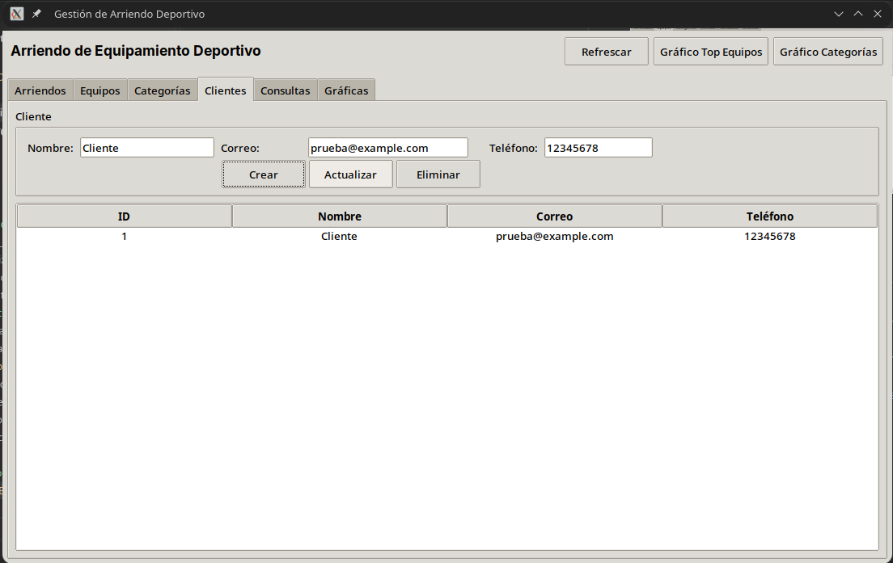
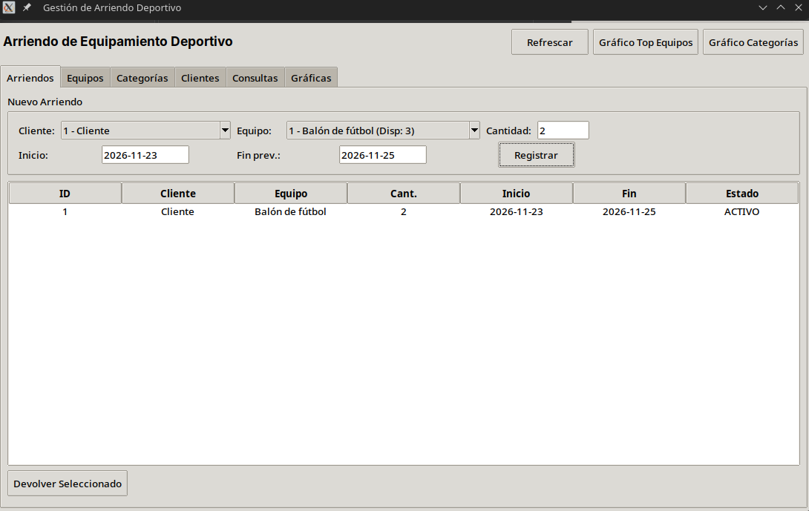
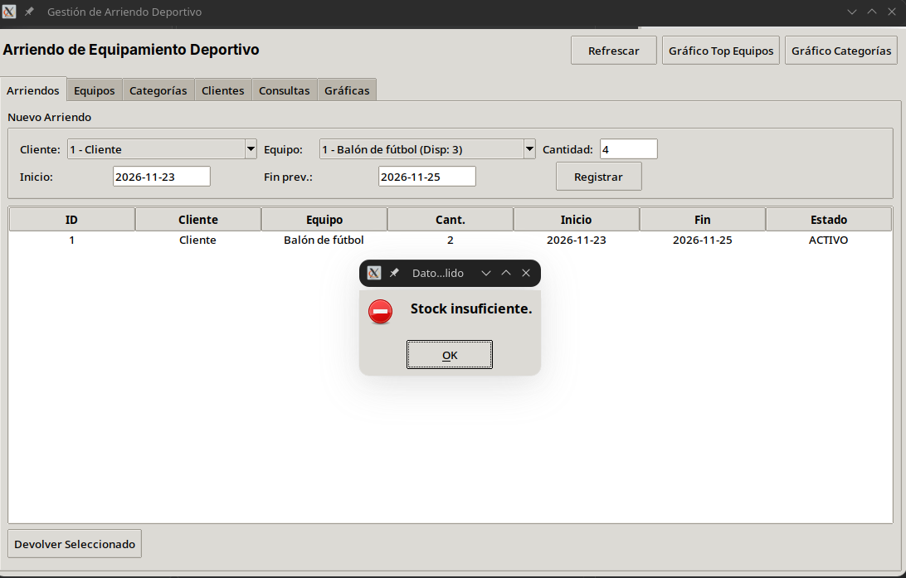
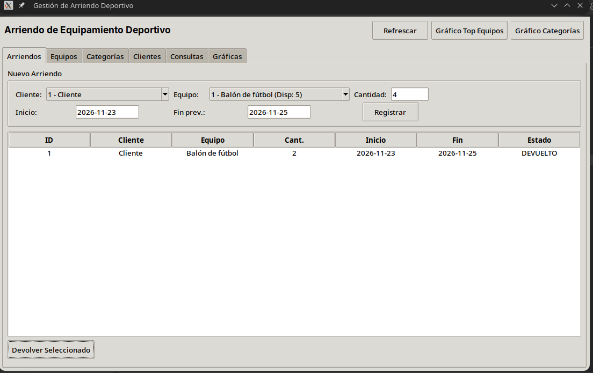
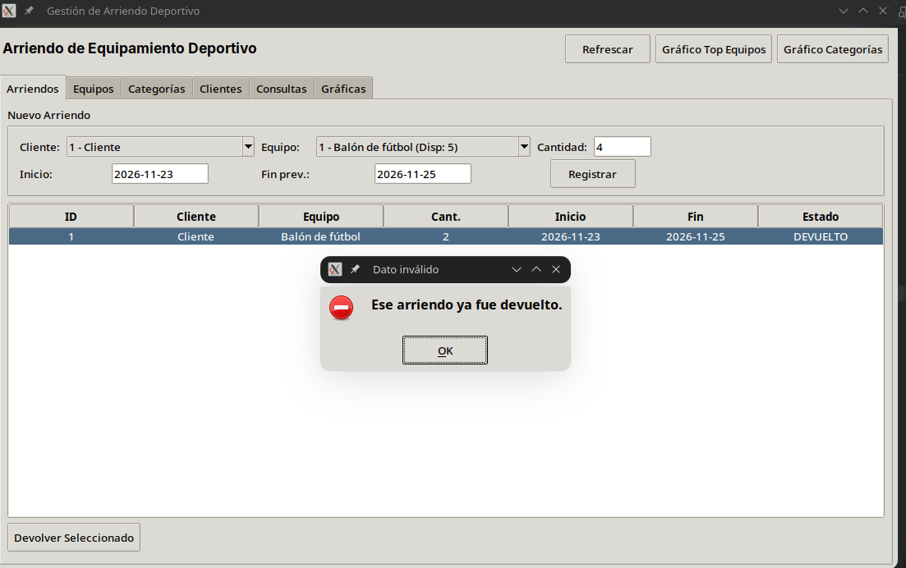
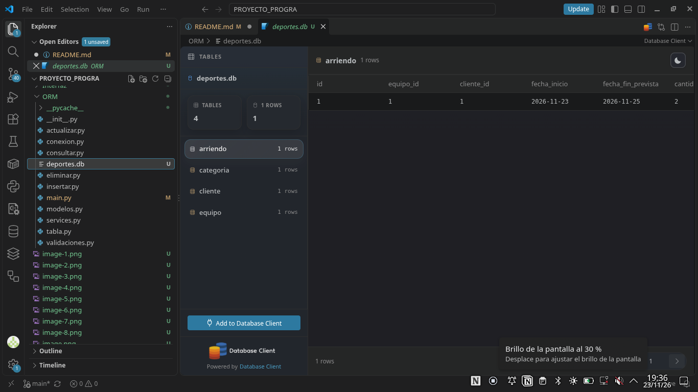
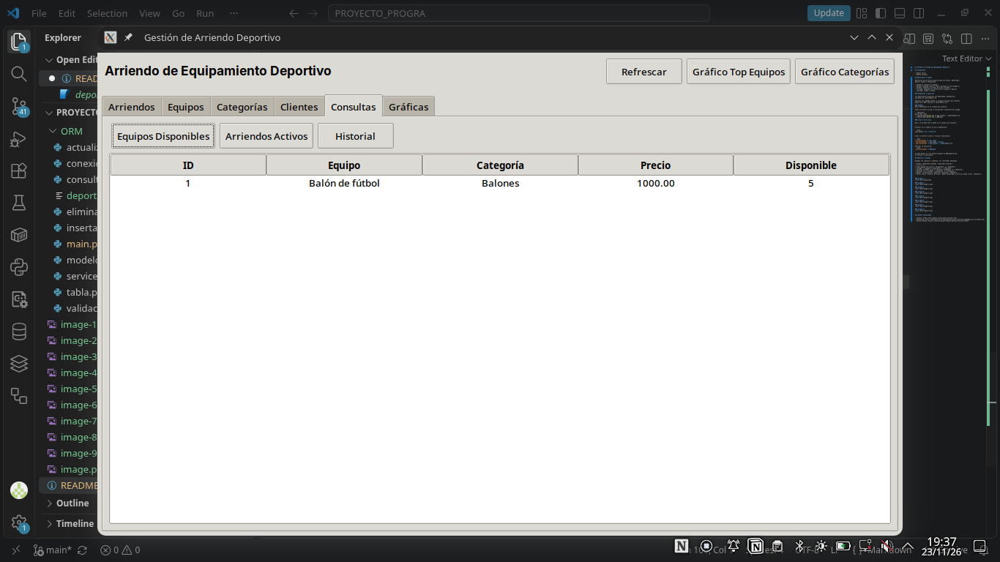
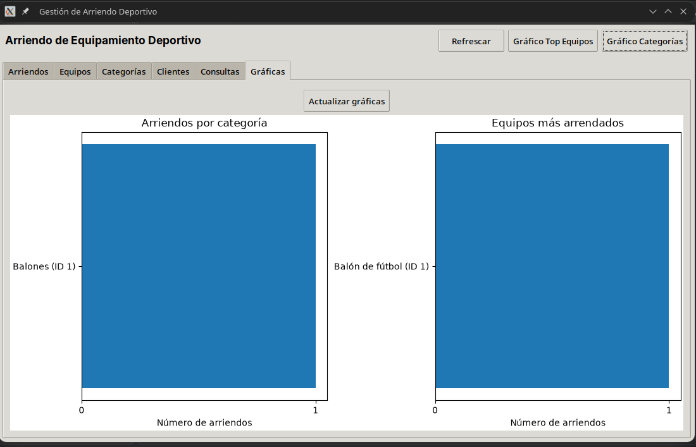

# Sistema de Arriendo de Equipamiento Deportivo

## Integrantes

- Miguel Torres
- Benito Carbonel

## Descripción y modelo

Aplicación de escritorio desarrollada con Python, SQLAlchemy,
SQLite, Tkinter y Matplotlib.

- Categoria: agrupa los equipos.
- Equipo: almacena precio y stock; pertenece a una categoría.
- Cliente: almacena los datos de quien arrienda.
- Arriendo: relaciona un cliente con un equipo y registra
  cantidad, fechas y estado.

## Tecnologías implementadas

### SQLAlchemy ORM y SQLite

Utilizamos SQLAlchemy para guardar, consultar, actualizar y
eliminar categorías, equipos, clientes y arriendos mediante
objetos de Python.

Se implementa en la carpeta `ORM`. Los modelos están definidos
en `modelos.py` y la conexión se configura en `conexion.py`.

SQLite almacena los datos en `ORM/deportes.db`, conservándolos
al cerrar la aplicación.

### Tkinter

Utilizamos Tkinter para crear la ventana, las pestañas, los
formularios, los botones y las tablas de la aplicación.

Se implementa principalmente en `Interfaz/ventana_principal.py`.
Los botones llaman a las funciones del ORM y muestran los
resultados o mensajes de error.

### Matplotlib

Utilizamos Matplotlib para mostrar dos gráficos: arriendos por
categoría y equipos más arrendados.

Se implementa en `Interfaz/graficas.py` y
`Interfaz/estadistica_G.py`. Los gráficos se integran en la
interfaz mediante `Interfaz/Formulario/estadistica.py`.

La información proviene de la base de datos y representa el
número de arriendos, no las unidades arrendadas.

### Factory Method

Utilizamos Factory Method para organizar la creación de equipos
según su categoría: Balon, Raqueta u OtroEquipo.

Se implementa en `ORM/factory_method.py` y se utiliza desde
`ORM/insertar.py`.

Cada creador construye el producto correspondiente, que después
se convierte en un modelo Equipo para guardarlo con SQLAlchemy.
Esto permite incorporar nuevos tipos de equipamiento.

## Instalación y ejecución

Se requiere tener Python 3 instalado.

Las bibliotecas necesarias son SQLAlchemy y Matplotlib,
incluidas en `requirements.txt`.

Ejecutar los comandos desde la carpeta principal del proyecto,
donde están ORM, Interfaz y requirements.txt.

### Windows

Abrir PowerShell en la carpeta del proyecto.

Crear el entorno virtual, instalar las bibliotecas y ejecutar:

```powershell
py -m venv .venv
.\.venv\Scripts\python.exe -m pip install -r requirements.txt
.\.venv\Scripts\python.exe -m ORM.main
```

### Linux — Arch Linux

Abrir la terminal del sistema en la carpeta del proyecto.

Instalar Tk si todavía no está disponible:

```bash
sudo pacman -Syu --needed tk
```

Crear el entorno virtual e instalar las bibliotecas:

```bash
/usr/bin/python -m venv .venv
.venv/bin/python -m ensurepip --upgrade
.venv/bin/python -m pip install -r requirements.txt
```

Ejecutar la aplicación:

```bash
.venv/bin/python -m ORM.main
```

La base SQLite se crea automáticamente en `ORM/deportes.db`
al iniciar la aplicación.

## 6. Pruebas mínimas de demostración

### Paso 1: Crear categoría y equipo

Crear categoría y equipo con stock total 5

**Resultado:** Stock disponible 5.


### Paso 2: Crear cliente y registrar un arriendo

Crear cliente y registrar arriendo de 2 unidades

**Resultado:** Stock disponible 3; arriendo ACTIVO.





### Paso 3: Intentar arrendar más unidades de las disponibles

Intentar arrendar 4 unidades adicionales

**Resultado:** Operación rechazada; stock sigue en 3



### Paso 4: Devolver el arriendo

Devolver arriendo de 2 unidades

**Resultado:** Stock disponible 5; estado DEVUELTO.



### Paso 5: Intentar devolver el mismo arriendo

Intentar devolver el mismo arriendo

**Resultado:** Operación rechazada; stock sigue en 5



### Paso 6: Comprobar persistencia y mostrar gráficos

Cerrar y reabrir aplicación; mostrar gráficos

**Resultado esperado:** Datos persistentes y gráficos basados en BD







## Fuentes consultadas

- Tkinter: https://docs.python.org/3/library/tkinter.html
- Matplotlib: https://matplotlib.org/stable/gallery/user_interfaces/embedding_in_tk_sgskip.html
- Factory Method: https://refactoring.guru/design-patterns/factory-method